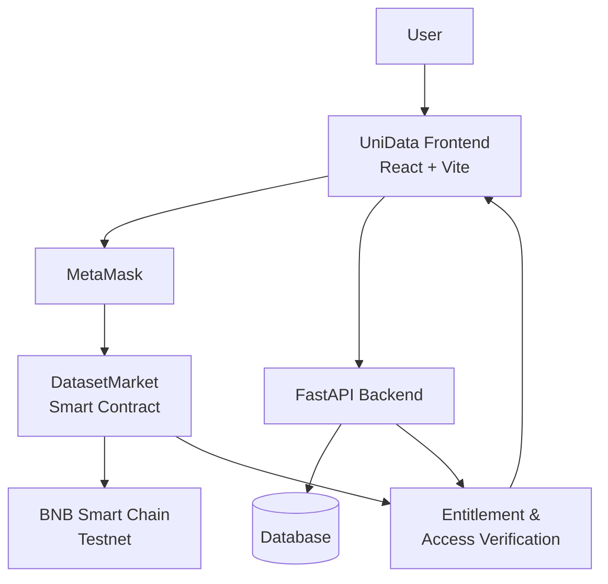

# UniData

> **A blockchain-powered dataset marketplace for discovering, evaluating, purchasing, and accessing datasets with verifiable ownership.**

UniData is a hybrid **Web2 + Web3 dataset marketplace** where users can discover datasets, evaluate their feasibility, connect a Web3 wallet, and purchase blockchain-backed datasets using **tBNB on the BNB Smart Chain Testnet**.

The platform combines a traditional dataset marketplace with:

* 📊 Dataset discovery and marketplace browsing
* 🤖 AI-powered dataset feasibility analysis
* 🦊 Web3 wallet integration
* 🔗 On-chain dataset registration
* 💰 tBNB-based dataset purchasing
* ✅ Blockchain purchase verification
* 🔄 Backend purchase synchronization
* 🔐 Purchase-based access control

---

## 🚀 Overview

UniData uses blockchain technology where it provides the most value: **payment, verification, and ownership state**.

Users can browse datasets through the UniData marketplace frontend. Blockchain-backed datasets are linked to records on the **BNB Smart Chain Testnet** and can be purchased through **MetaMask** using tBNB.

The blockchain maintains an independently verifiable purchase state, while the backend manages:

* Marketplace dataset records
* Purchase records
* Transaction synchronization
* Entitlement verification
* Access-control logic

Large dataset files are **not stored directly on the blockchain**. This hybrid architecture keeps the system practical while using blockchain for verifiable ownership and payment.

---

# ✨ Key Features

## 📊 Dataset Marketplace

Users can:

* Browse available datasets
* View dataset details
* View dataset metadata and status
* Evaluate dataset feasibility
* Review dataset quality information
* Purchase blockchain-backed datasets

---

## 🤖 AI/ML Dataset Analysis

UniData provides an AI-powered dataset feasibility/readiness assessment to help users understand whether a dataset is suitable for machine-learning workflows.

The current interface demonstrates:

* **Feasibility Score**
* **Dataset Grade**
* **Dataset Strengths**
* **Dataset Analysis Information**

The AI/ML layer is designed to help users make more informed decisions before purchasing a dataset.

---

## 🔗 Blockchain Integration

Blockchain-backed datasets are registered against the **DatasetMarket** smart contract deployed on the **BNB Smart Chain Testnet**.

### Current Network

| Property | Value                   |
| -------- | ----------------------- |
| Network  | BNB Smart Chain Testnet |
| Chain ID | `97`                    |
| Currency | tBNB                    |

---

## 💰 Blockchain Purchase

A typical blockchain-backed purchase follows this process:

1. Connect MetaMask
2. Open a blockchain-backed dataset
3. Select **Purchase**
4. Confirm the transaction in MetaMask
5. Pay the dataset price in tBNB
6. Wait for blockchain confirmation
7. Synchronize the successful purchase with the backend
8. Verify the purchase entitlement
9. Receive authorized dataset access

### Verified Demonstration Dataset Price

```text
0.001 tBNB
```

---

## ✅ On-Chain Purchase Verification

The frontend verifies whether a wallet has already purchased a dataset using the smart contract function:

```solidity
hasAddressPurchased()
```

This allows UniData to recognize an existing purchase even after:

* Page refresh
* Wallet reconnection
* Frontend state reset

The blockchain therefore acts as an independently verifiable source of purchase state.

---

# 🔐 Backend Entitlement & Access Control

After a successful blockchain purchase, the backend records the relevant purchase information:

| Purchase Data      | Description                       |
| ------------------ | --------------------------------- |
| Dataset ID         | Purchased dataset identifier      |
| Buyer Wallet       | Wallet address of the purchaser   |
| Transaction Hash   | Blockchain transaction identifier |
| Purchase Amount    | Amount paid in tBNB               |
| Purchase Timestamp | Time of purchase                  |

The backend then verifies whether the connected wallet is entitled to access the dataset.

### Access Logic

```text
Wallet
   │
   ▼
Has the wallet purchased the dataset?
   │
   ├── YES ──► Grant Access
   │
   └── NO ───► Reject Access
```

Both the blockchain purchase state and backend purchase records participate in the verified purchase workflow.

---

# 🦊 MetaMask Integration

MetaMask is used for:

* Wallet connection
* Account detection
* BNB Smart Chain Testnet interaction
* Transaction signing
* tBNB payments

---

# 🔄 End-to-End Purchase Flow

```text
User
  │
  ▼
UniData Frontend
  │
  ▼
Connect MetaMask
  │
  ▼
Open Blockchain-backed Dataset
  │
  ▼
Purchase Dataset
  │
  ▼
MetaMask Transaction
  │
  ▼
DatasetMarket Smart Contract
  │
  ▼
BNB Smart Chain Testnet Confirmation
  │
  ▼
Transaction Hash
  │
  ▼
Backend Synchronization
  │
  ▼
Purchase Record
  │
  ▼
Entitlement Verification
  │
  ▼
Authorized Dataset Access
```

### Separation of Responsibilities

The blockchain transaction and backend purchase record are intentionally separated.

**Blockchain provides:**

* Independently verifiable purchase state
* Wallet-based identity
* On-chain ownership/purchase state
* Transparent transaction history
* Decentralized payment

**Backend provides:**

* Marketplace records
* Purchase synchronization
* Database persistence
* Entitlement verification
* Access-control logic

---

# 🏗️ System Architecture



### Architecture Components

| Layer      | Technology                             | Responsibility                                    |
| ---------- | -------------------------------------- | ------------------------------------------------- |
| Frontend   | React + Vite + TypeScript              | Marketplace UI and user interaction               |
| Web3       | MetaMask + ethers.js                   | Wallet connection and blockchain transactions     |
| Backend    | Python + FastAPI                       | APIs, purchase synchronization and access control |
| Database   | SQLAlchemy-based persistence           | Dataset and purchase records                      |
| Blockchain | Solidity + Hardhat                     | Dataset registration and purchase verification    |
| Network    | BNB Smart Chain Testnet                | Blockchain transaction execution                  |
| AI/ML      | Dataset feasibility/readiness analysis | Dataset evaluation and ML-oriented assessment     |

---

# 🧪 Verified BSC Testnet Demonstration

The current implementation has been tested end-to-end using a dedicated blockchain-backed dataset.

The verified flow includes:

* ✅ Dataset registered on BSC Testnet
* ✅ Wallet connected through MetaMask
* ✅ Purchase initiated from the frontend
* ✅ Transaction confirmed on BSC Testnet
* ✅ Transaction hash recorded
* ✅ Backend purchase record created
* ✅ On-chain `hasAddressPurchased()` verification returns `true`
* ✅ Purchased state restored after refresh/reconnect
* ✅ Authorized wallet receives access
* ✅ Unauthorized wallet is rejected

---

# 📜 Smart Contract

### DatasetMarket

```text
Contract Address:
0x4Ccd91247B98df05dCF18aBd70F27367DFcd9da4
```

### Network Information

```text
Network:   BNB Smart Chain Testnet
Chain ID:  97
Currency:  tBNB
```

---

# 🛠️ Tech Stack

## Frontend

* React
* Vite
* TypeScript
* ethers.js
* MetaMask
* Web3 wallet integration

## Backend

* Python
* FastAPI
* SQLAlchemy
* REST APIs
* Blockchain service layer

## Blockchain

* Solidity
* Hardhat
* ethers.js
* BNB Smart Chain Testnet
* DatasetMarket smart contract

## Database

* SQLAlchemy-based persistence
* Dataset records
* Purchase records
* Blockchain dataset mapping

## AI/ML

* Dataset feasibility/readiness analysis
* ML-oriented dataset evaluation
* AI/ML workflow integration

---

# 🎯 Why Blockchain?

UniData does **not** store the actual dataset files directly on the blockchain.

Instead, blockchain is used for the parts where verifiability matters most:

* Wallet-based identity
* Purchase verification
* On-chain ownership/purchase state
* Transparent transaction history
* Decentralized payment

Large dataset files remain outside the blockchain.

This hybrid architecture is more practical than attempting to store large datasets directly on-chain while still providing users with verifiable purchase information.

---

# 🔐 Security & Access-Control Model

A user's wallet address is associated with the blockchain purchase.

The system verifies whether the wallet has purchased the requested dataset before granting access.

```text
                    Wallet
                       │
                       ▼
            ┌─────────────────────┐
            │ Purchase Verification│
            └──────────┬──────────┘
                       │
              Has wallet purchased?
                    /       \
                  YES        NO
                   │          │
                   ▼          ▼
             Grant Access   Reject Access
```

The verified purchase workflow combines:

1. Blockchain purchase state
2. Transaction information
3. Backend purchase records
4. Wallet entitlement verification

---

# 📊 Current Project Status

## ✅ Completed

* [x] Dataset marketplace UI
* [x] Dataset detail pages
* [x] Dataset metadata and status display
* [x] Wallet connection
* [x] MetaMask integration
* [x] BNB Smart Chain Testnet integration
* [x] Dataset-to-blockchain mapping
* [x] DatasetMarket smart contract integration
* [x] tBNB purchase flow
* [x] On-chain purchase verification
* [x] Backend purchase synchronization
* [x] Purchase record persistence
* [x] Entitlement verification
* [x] Unauthorized access rejection
* [x] Purchased-state restoration after refresh/reconnect
* [x] Production frontend build
* [x] End-to-end BSC Testnet testing

---

# 🔮 Future Scope

The current architecture can be extended with:

* BNB Greenfield integration
* IPFS-based decentralized dataset storage
* Automated royalty distribution
* Advanced dataset provenance
* Event indexing
* Production-grade authentication
* More sophisticated AI/ML pipelines
* Dataset versioning
* Contributor analytics
* Automated model-training workflows
* BNB Smart Chain Mainnet deployment

These are extensions to the current implementation and are **not requirements for the current BSC Testnet demonstration**.

---

# 👥 Team Responsibilities

## Blockchain / Backend

* System architecture
* FastAPI backend
* Database integration
* Smart contract integration
* BSC Testnet integration
* Purchase verification
* Backend synchronization
* Access-control logic

## Frontend / Web3 UI

* React marketplace
* Dataset pages
* MetaMask integration
* Purchase interface
* Wallet state management
* Purchased/download UI

## AI/ML

* Dataset feasibility analysis
* ML-readiness evaluation
* AI/ML workflow demonstration
* Future model-training integration

## Product / Pitch

* Problem definition
* User journey
* Presentation
* Storytelling
* Future scope
* Product positioning

---

# 📌 Project Vision

UniData aims to become a trusted marketplace for datasets where contributors can monetize their data and users can discover, evaluate, purchase, and obtain datasets with verifiable ownership and controlled access.

The long-term vision is to combine:

```text
AI + Data + Blockchain
```

to build trusted infrastructure for the **AI data economy**.

---

# 📄 License

This project is licensed under the **MIT License**.
